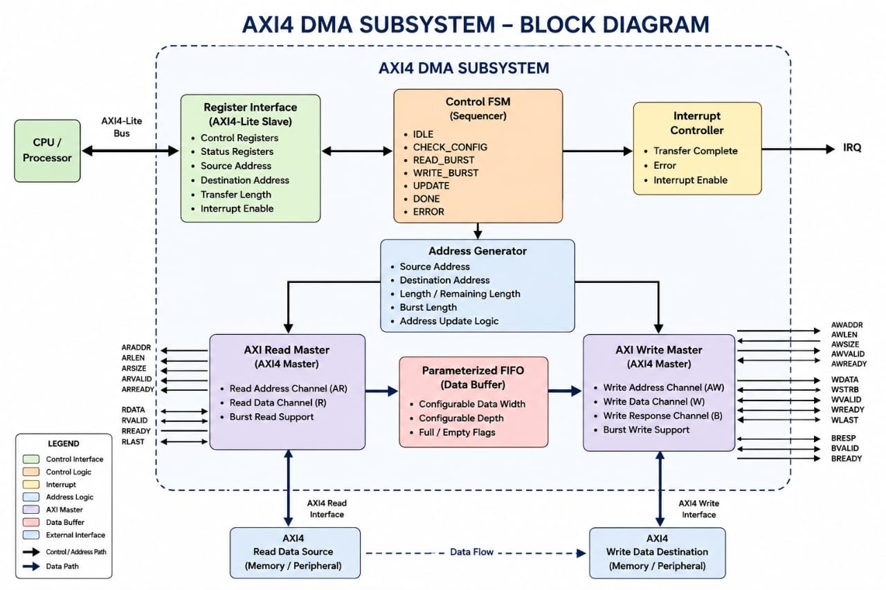
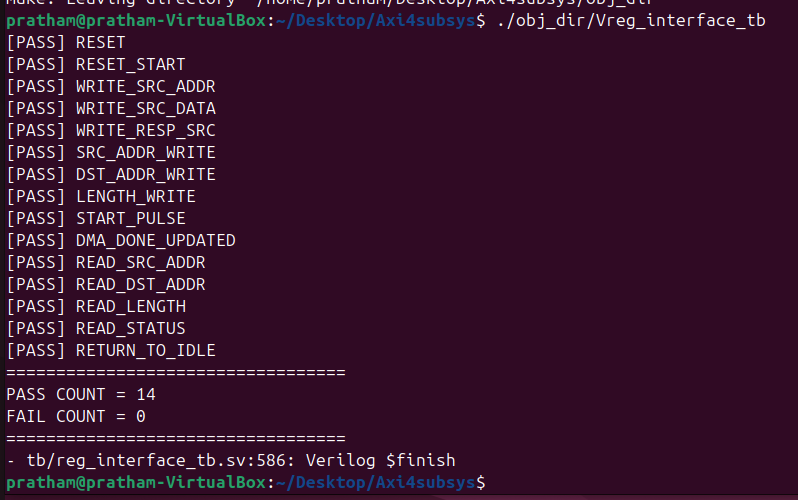
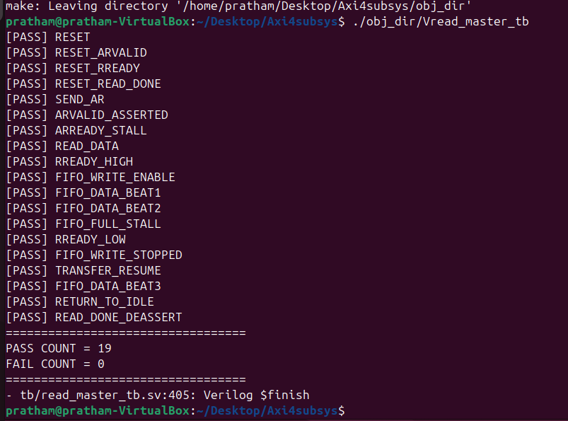
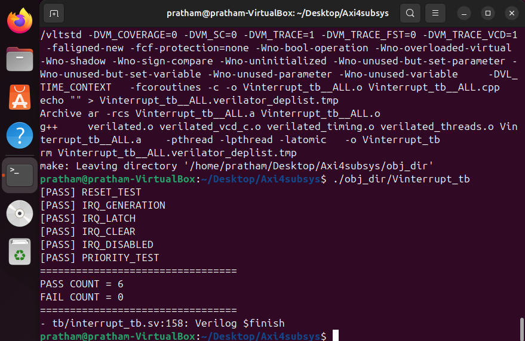

# AXI4 DMA Subsystem

A parameterized AXI4 Direct Memory Access (DMA) Subsystem designed in SystemVerilog.
The project implements an AXI4-based DMA engine capable of transferring data between
memory regions with minimal CPU intervention.The design follows a modular RTL
architecture and is verified using simulation.

## Features

- AXI4-Lite Register Interface
- AXI Read Master
- AXI Write Master
- Control FSM
- Address Generator
- Parameterized FIFO
- Interrupt Controller
- Modular and parameterized RTL design
- Synthesizable SystemVerilog implementation

## Tools Used

- SystemVerilog
- Verilator
- GTKWave
- Yosys
- Ubuntu Linux
- Git & GitHub

## Project Structure

```text
AXI4-DMA-Subsystem/
├── rtl/                 # RTL source files
├── tb/                  # Testbench files
├── netlist/             # Synthesis outputs
├── README.md            # Project documentation
└── .gitignore           # Git ignore rules 
```

## Block Diagram



## Simulation Results

### FIFO

**Waveform**


---

### Address Generator

**Waveform**


**Terminal Output**


---

### Control FSM

**Waveform**


**Terminal Output**


---

### Register Interface

**Waveform**


**Terminal Output**



---

### Read Master

**Waveform**


**Terminal Output**



---

### Write Master

**Waveform**


**Terminal Output**


---

### Interrupt Controller

**Waveform**


**Terminal Output**


