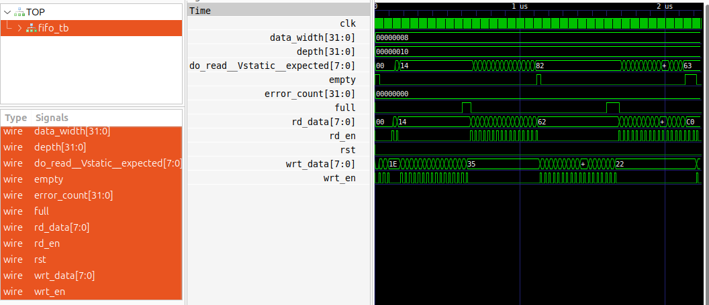
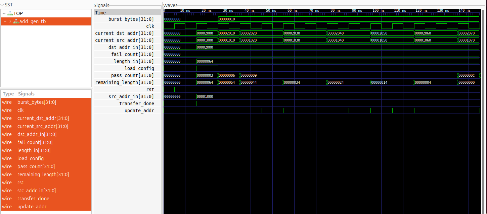
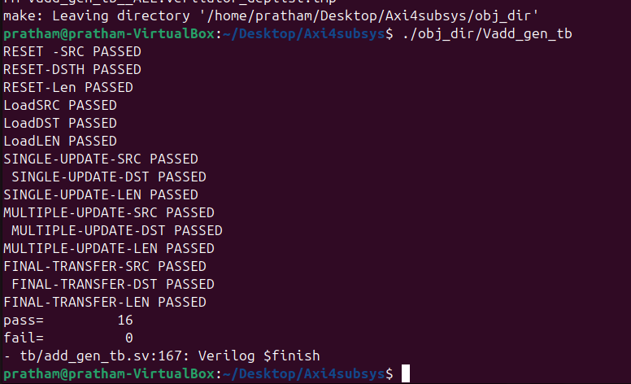
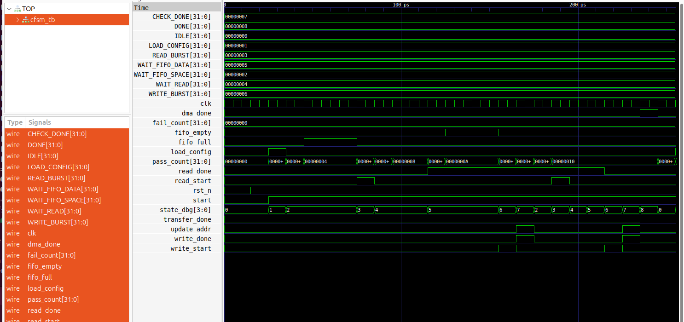
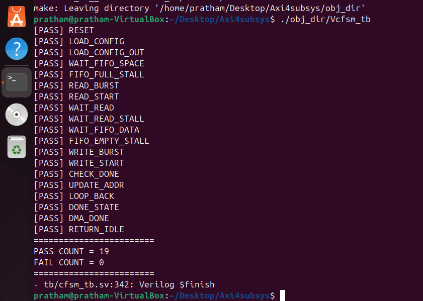
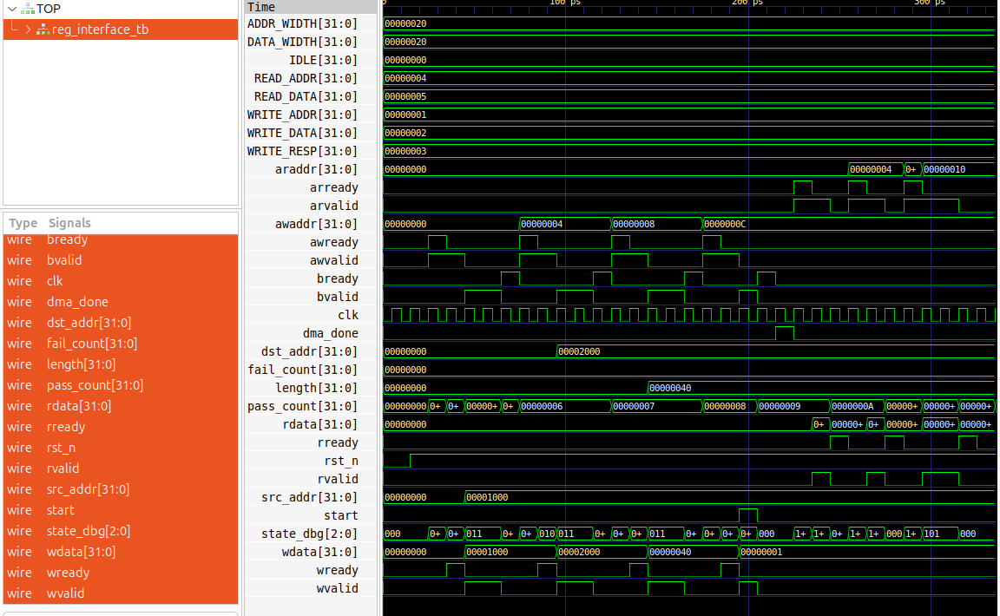
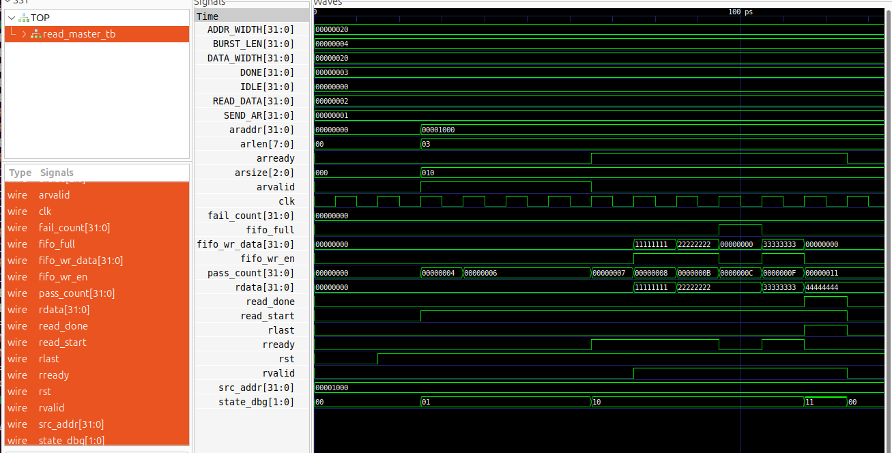
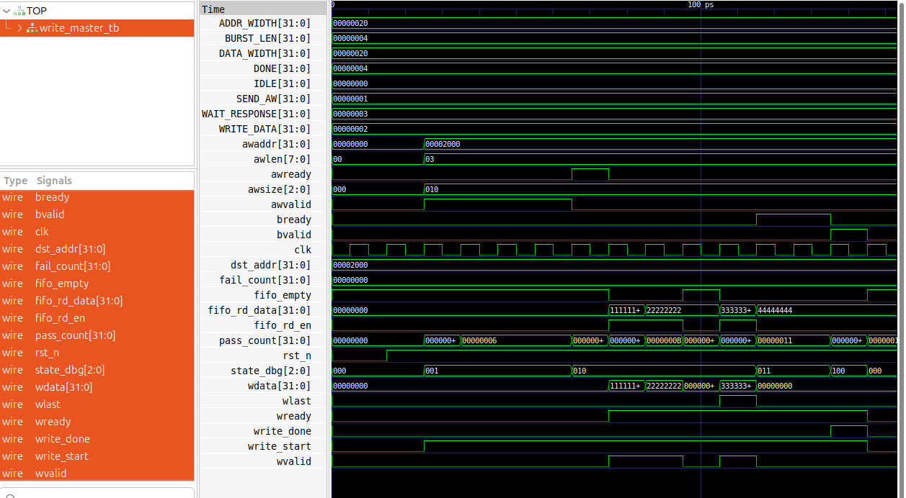
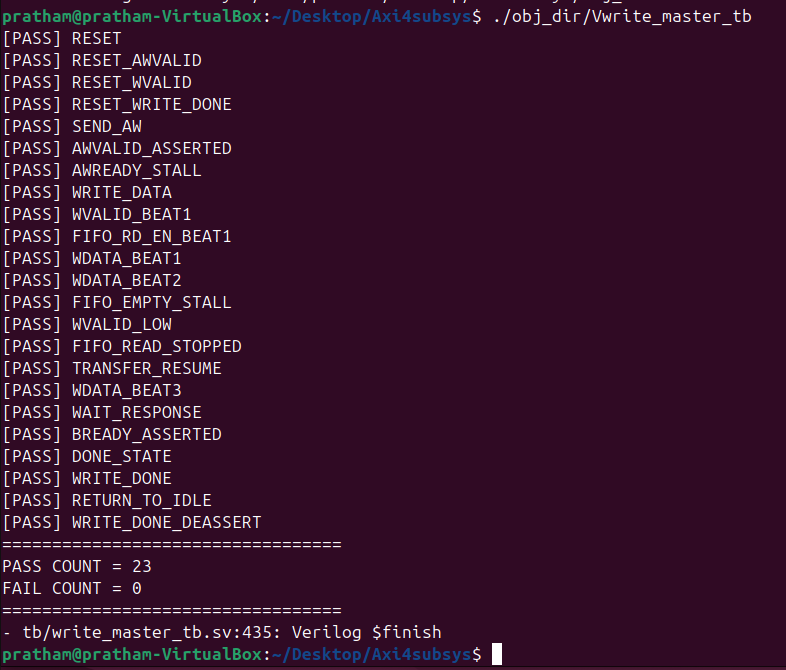
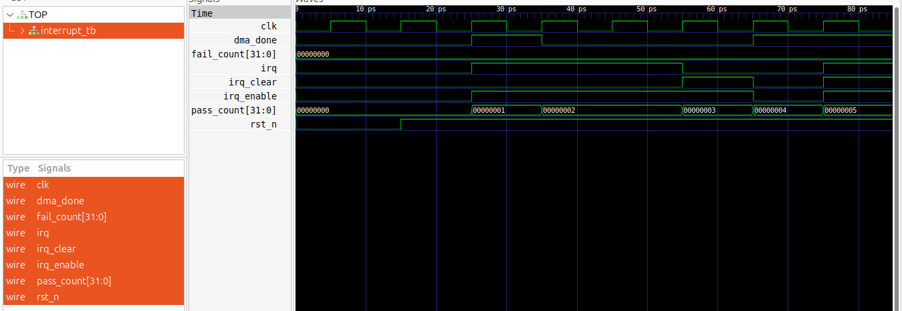

# AXI4 DMA Controller

A parameterized AXI4 Direct Memory Access (DMA) Subsystem designed in SystemVerilog. The project implements an AXI4-based DMA engine capable of transferring data between memory regions with minimal CPU intervention. The design follows a modular RTL architecture and is verified using simulation.

## Features

- AXI4-Lite Register Interface
- AXI Read Master
- AXI Write Master
- Control FSM
- Address Generator
- Parameterized FIFO
- Interrupt Controller
- Modular and parameterized RTL design
- Synthesizable SystemVerilog implementation

## Tools Used

- SystemVerilog
- Verilator
- GTKWave
- Yosys
- Ubuntu Linux
- Git & GitHub

## Project Structure

```text
AXI4-DMA-Controller/
├── rtl/                 # RTL source files
├── tb/                  # Testbench files
├── docs/
│   ├── block_diagram.png
│   ├── waveform/        # Simulation waveform screenshots
│   └── terminal_output/ # Terminal output screenshots
├── README.md
└── .gitignore
```

## Block Diagram


## Simulation Results

### 1. FIFO

**Waveform**



### 2. Address Generator

**Waveform**



**Terminal Output**



### 3. Control FSM

**Waveform**



**Terminal Output**



### 4. Register Interface

**Waveform**



**Terminal Output**


### 5. Read Master

**Waveform**



**Terminal Output**


### 6. Write Master

**Waveform**



**Terminal Output**



### 7. Interrupt Controller

**Waveform**



**Terminal Output**


## Team Contributions

Developed as a collaborative academic project.

## My Contribution

- Address Generator
- Interrupt Controller
- Top-level integration
-
